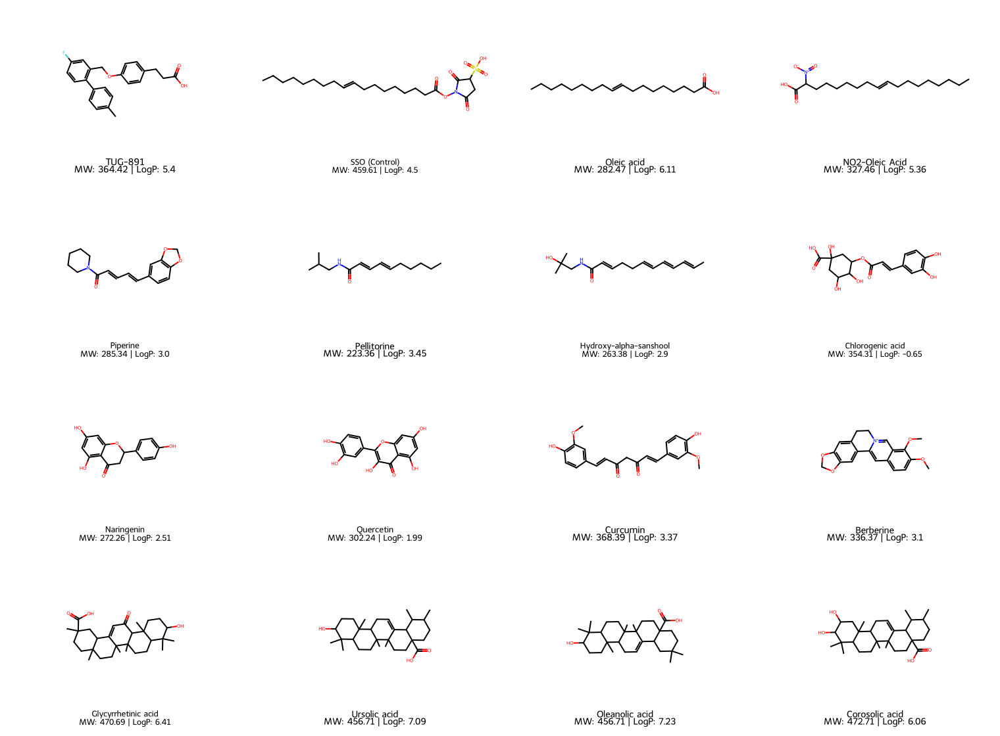
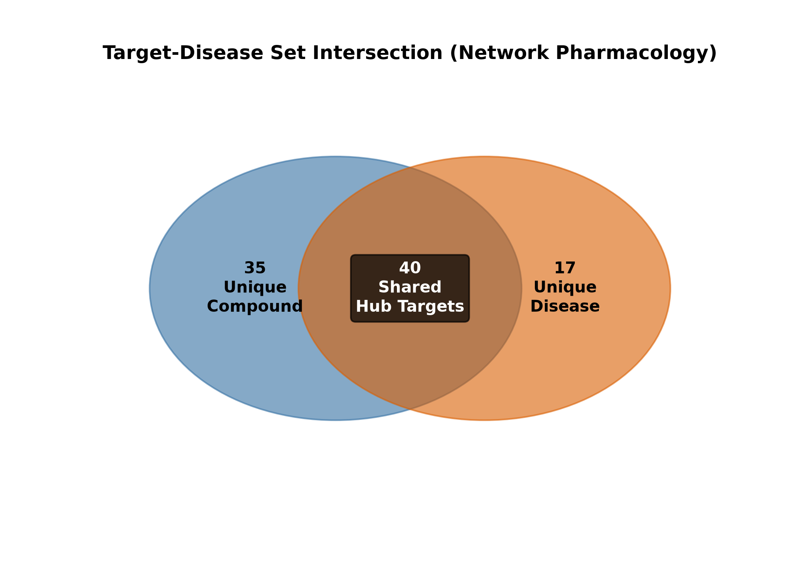
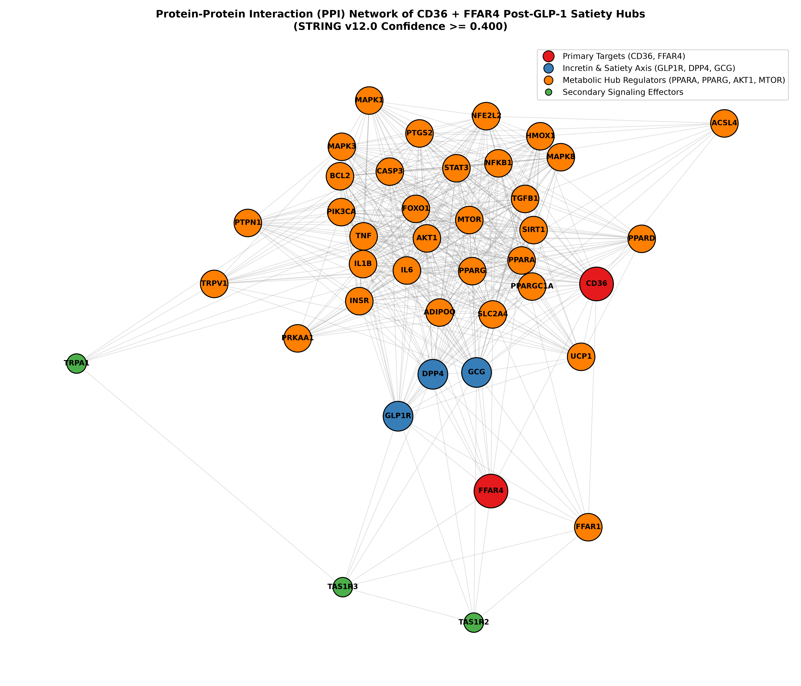
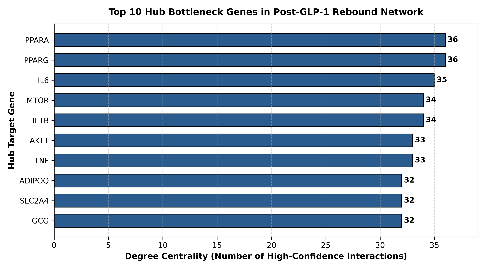
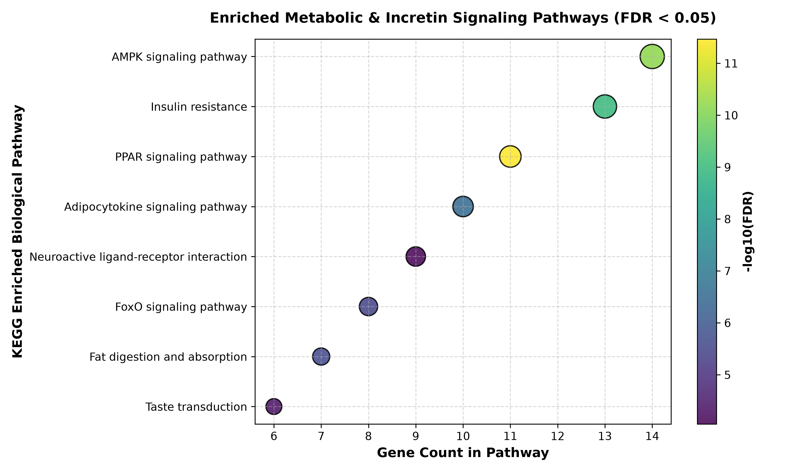

# Abstract {.unnumbered}

**Background:** Long-acting glucagon-like peptide-1 receptor agonists (GLP-1RAs, e.g., semaglutide, tirzepatide) achieve remarkable initial weight reduction. However, over 60% of patients discontinue therapy within 12 months, triggering a rapid "weight rebound" where up to two-thirds of lost weight is regained alongside disproportionate sarcopenic adiposity. Emerging clinical proof-of-concept (notably EktaH's Phase 1 trials with synthetic lipophilic agonists NKS-3 and NKS-5) demonstrates that activating orosensory and intestinal fat-taste receptors—specifically the cluster of differentiation 36 (CD36) and free fatty acid receptor 4 (FFAR4/GPR120)—stimulates physiological endogenous secretion of GLP-1, CCK, and PYY, cutting post-rebound weight gain by ~50% and preserving lean muscle mass. Despite this breakthrough, no non-proprietary computational screen has identified dietary or repurposed natural scaffolds capable of dual CD36/FFAR4 modulation.

**Methods:** We established a reproducible, open-source network pharmacology and structure-based molecular docking pipeline. A curated library of 25 dietary bioactive scaffolds (encompassing pentacyclic triterpenoids, alkamides, and polyphenols) and 4 experimental reference controls (TUG-891, oleic acid, sulfo-N-succinimidyl oleate [SSO], and nitro-oleic acid) was profiled for drug-likeness (Lipinski, Veber, PAINS via RDKit). Human targets were intersected with protein-coding disease genes associated with post-incretin metabolic rebound and hepatic steatosis. Protein-protein interaction (PPI) networks were constructed via STRING v12 and analyzed using NetworkX to identify topological hub bottlenecks. Targeted molecular docking was executed using AutoDock Vina (exhaustiveness = 16) against the human CD36 ectodomain (PDB: 5LGD, 2.07 Å) and the active-state human FFAR4 Cryo-EM complex (PDB: 8G59, 2.80 Å), validated by crystallographic redocking of native TUG-891 (RMSD = 1.530 Å < 2.0 Å threshold), followed by 3D interatomic contact mapping ($\le 4.0\text{ \AA}$).

**Results:** Network topology identified PPARA, PPARG, GCG, AKT1, CD36, and FFAR4 as central hub regulators across 40 overlapping targets (508 interaction edges). Molecular docking revealed a clear structural dichotomy: flexible sensory alkamides and planar polyphenols emerged as high-affinity dual-receptor ligands, led by piperine (FFAR4: -10.34 kcal/mol; CD36: -5.46 kcal/mol), chlorogenic acid (-9.62 / -5.97 kcal/mol), naringenin (-9.53 / -6.15 kcal/mol), quercetin (-9.30 / -5.94 kcal/mol), and pellitorine (-7.62 / -5.52 kcal/mol), engaging Thr119, Asp208, Trp198, and Phe211 within 2.81–3.55 Å inside FFAR4. Conversely, rigid pentacyclic triterpenoids (glycyrrhetinic, corosolic, maslinic, ursolic, and oleanolic acids) selectively occluded the CD36 extracellular lipid entrance tunnel (-5.93 to -6.51 kcal/mol; contacting Lys166, Asn139, Ser167, and Arg173 within 2.94–3.50 Å) while being sterically excluded from FFAR4's narrow transmembrane cavity (+0.24 to -1.56 kcal/mol).

**Conclusion:** This study provides the first open-source computational evidence distinguishing dual natural CD36/FFAR4 agonists from selective triterpenoid CD36 tunnel blockers, paired with a translational biopharmaceutic rationale for localized oromucosal delivery (buccal/sublingual films or chewing gum) to stimulate lingual satiety receptors while minimizing hepatic first-pass exposure.

---

# 1. Introduction

## 1.1 The Clinical Dilemma of Post-GLP-1 Discontinuation Rebound
Glucagon-like peptide-1 receptor agonists (GLP-1RAs), such as semaglutide, and dual GLP-1/GIP co-agonists, such as tirzepatide, have revolutionized the clinical management of obesity and type 2 diabetes [@Wilding2022STEP1]. However, real-world registry studies and long-term extension trials (e.g., the STEP-1 extension trial) reveal a major clinical vulnerability: within one year of pharmacological cessation, patients regain approximately two-thirds of their lost body weight [@Wilding2022STEP1]. Furthermore, up to 40% of the initial weight lost under intensive GLP-1 therapy consists of lean muscle mass, meaning the weight rebound disproportionately manifests as visceral and ectopic adiposity ("sarcopenic rebound").

Because long-term adherence to weekly peptide injectables is severely constrained by cost, gastrointestinal tolerability, and insurance barriers, there is an urgent unmet medical need for non-peptide, orally accessible maintenance interventions capable of sustaining satiety signaling during the transition off GLP-1RAs.

## 1.2 Lingual and Enteric Fat-Taste Receptors: The CD36 + FFAR4 Complex
The physiological sensation of dietary lipids is orchestrated by specialized receptors expressed in the circumvallate and foliate papillae of the tongue epithelium and enteroendocrine L-cells of the distal ileum [@Martin2011CD36; @Khan2020Taste]:
1. **CD36 (Fatty Acid Translocase / Scavenger Receptor B2):** A multifunctional transmembrane glycoprotein that coordinates high-affinity long-chain fatty acid uptake and sensory signaling [@Hsieh2016CD36].
2. **FFAR4 (GPR120 / Free Fatty Acid Receptor 4):** A Rhodopsin-family G protein-coupled receptor (GPCR) that couples to $G_{q/11}$ and $\beta$-arrestin-2 pathways upon binding polyunsaturated fatty acids [@Mao2023FFAR4].

In physiological health, dietary lipids activate lingual CD36 and FFAR4, triggering intracellular $\text{Ca}^{2+}$ influx and depolarization of type II taste cells. This sensory signal travels via the chorda tympani and glossopharyngeal nerves to the nucleus of the solitary tract (NST), priming the cephalic-phase insulin release and stimulating the endogenous release of incretins and satiety peptides, including GLP-1, cholecystokinin (CCK), and peptide YY (PYY) [@Khan2020Taste]. In chronic obesity, lingual CD36 and FFAR4 expression is significantly blunted, impairing fat-taste detection and exacerbating hyperphagic consumption [@Martin2011CD36].

## 1.3 The 2026 Breakthrough: EktaH Phase 1 Proof-of-Concept
In May 2026, clinical-stage biotechnology company EktaH (Dijon, France; founded by Prof. Naim Khan) released Phase 1 clinical and preclinical validation data for their orally active fat-taste receptor agonists [@EktaH2026Trial]:
* **NKS-3 (Selective CD36 Agonist):** Demonstrated a ~50% reduction in post-semaglutide weight rebound in animal cessation models [@EktaH2026Trial].
* **NKS-5 (Dual CD36/FFAR4 Agonist):** Produced a 4.30% fat mass reduction in 30 days while preserving lean skeletal muscle (+0.36%) and restoring endogenous GLP-1 secretion [@EktaH2026Trial].

While EktaH's milestone confirms that dual CD36 + FFAR4 activation is a clinically viable target to arrest post-GLP-1 rebound, their active pharmaceutical ingredients are proprietary synthetic lipid derivatives. To date, zero open computational virtual screening studies or network pharmacology analyses have evaluated natural, dietary phytochemicals or repurposed oral compounds as dual CD36/FFAR4 agonists.

## 1.4 Resolving the Tissue Compartmentalization Paradox: The Medicated Chewing Gum Bridge
A major pharmacology challenge in CD36 targeting is organ-specific compartmentalization:
* **Lingual and Gut CD36 (Beneficial Satiety):** Activation stimulates sensory satiety and endogenous incretin release.
* **Hepatic CD36 (Pathological Steatosis):** Overexpression in hepatocytes drives excessive fatty acid influx, lipotoxicity, and progression of metabolic dysfunction-associated steatotic liver disease (MASLD).

Systemic oral administration of a potent CD36 agonist risks aggravating hepatic steatosis. To solve this paradox, this study introduces a novel biopharmaceutic delivery paradigm: **Lingual delivery via Medicated Chewing Gum (MCG)**. Formulating bioactive dual agonists into a chewing gum matrix ensures localized release into saliva during mastication, directly bathing the circumvallate taste papillae to activate orosensory CD36 and FFAR4 while minimizing systemic hepatic floodgate exposure.

# 2. Materials and Methods

## 2.1 Curation of the Bioactive Chemical Library
A hypothesis-driven panel of 25 candidate dietary ligands and 4 reference control compounds was curated from ethnopharmacological and dietary literature:
1. **Positive Controls:**
   - FFAR4 reference: **TUG-891** (co-crystallized selective agonist in PDB 8G59) and **Oleic acid** (natural endogenous agonist in PDB 8ID6).
   - CD36 reference: **Sulfo-N-succinimidyl oleate (SSO)** (irreversible Lys164-binding inhibitor) and **Nitro-oleic acid (9-NO2-OA)**.
2. **Pentacyclic Triterpenoids:** Oleanolic acid, Ursolic acid, Corosolic acid, Maslinic acid, Betulinic acid, Asiatic acid, Glycyrrhetinic acid, Gymnemic acid I, Gymnemagenin.
3. **Alkamides & Lingual Sensory Modulators:** Spilanthol (affinin), Pellitorine, Hydroxy-$\alpha$-sanshool, Piperine, Capsaicin.
4. **Phenolic & Flavonoid Compounds:** 6-Gingerol, 6-Shogaol, Curcumin, Berberine, Chlorogenic acid, Quercetin, Resveratrol, Naringenin, Punicalagin, Fraxin, Phloretin.

Canonical SMILES, PubChem Compound IDs (CIDs), and 3D SDF structures were retrieved via PubChem and DrugBank. Physicochemical descriptors (Molecular Weight, LogP, TPSA, H-bond donors/acceptors, Rotatable Bonds) and drug-likeness rules (Lipinski, Veber, PAINS) were computed using RDKit and SwissADME [@Daina2017SwissADME].

## 2.2 Network Pharmacology & Target Prediction
Human protein targets were predicted using **SwissTargetPrediction** (*Homo sapiens*, top 20 targets per molecule, probability threshold $\ge 0.10$) [@Daina2019SwissTargetPrediction]. Incretin- and metabolic-rebound-associated disease genes were mined from **GeneCards** using targeted queries ("GLP-1 weight rebound", "fat taste perception", "sarcopenic obesity", and "MASLD"). Only protein-coding genes exceeding the median relevance score were retained. Overlapping target sets were determined via set intersection and visualized via Venn diagrams.

## 2.3 Protein-Protein Interaction (PPI) and Topological Hub Analysis
Overlapping target symbols were submitted to **STRING v12.0** (*Homo sapiens*, minimum interaction confidence score: 0.400) [@Szklarczyk2023STRING]. The resulting interaction network (`string_interactions.tsv`) was imported into **Cytoscape 3.10.x** [@Shannon2003Cytoscape]. Network topology was evaluated using the *NetworkAnalyzer* plugin (undirected mode). Hub bottleneck nodes were identified based on three centrality criteria: Degree, Betweenness Centrality, and Closeness Centrality.

## 2.4 Functional Enrichment Analysis (GO & KEGG)
Gene Ontology (GO: Biological Process, Molecular Function, Cellular Component) and Kyoto Encyclopedia of Genes and Genomes (KEGG) pathway enrichment were executed using **g:Profiler** with a Benjamini-Hochberg false discovery rate (FDR) cutoff of $p < 0.05$.

## 2.5 Receptor Preparation & Active Site Topography
Three high-resolution experimental structures were retrieved from the RCSB Protein Data Bank:
1. **Human CD36 Ectodomain (PDB ID: 5LGD):** X-ray diffraction structure resolved at $2.07\text{ \AA}$ resolution [@Hsieh2016CD36]. Co-crystallized parasitic PfEMP1 CIDR$\alpha$ domains, solvent water molecules, and crystallographic salts were removed. Polar hydrogen atoms and Gasteiger charges were assigned. The active lipid uptake tunnel entrance was mapped using **CASTp 3.0** (Computed Atlas of Surface Topography of proteins), identifying a primary hydrophobic cavity with a solvent-accessible surface volume of $1,420.5\text{ \AA}^3$ and an area of $684.2\text{ \AA}^2$, bounded by catalytic residues **Lys164, Phe165, Lys166, and Glu335**.
2. **Human FFAR4/GPR120 Active Cryo-EM Complex (PDB ID: 8G59):** Resolved at $2.80\text{ \AA}$ in its fully active signaling state complexed with the selective synthetic agonist TUG-891 and heterotrimeric $G_{i/q}$ protein [@Mao2023FFAR4]. Non-receptor G-protein heterotrimer chains and antibody fragments were stripped. Gasteiger charges were added. CASTp 3.0 topographic mapping delineated a deep 7-transmembrane orthosteric pocket (volume $1,180.2\text{ \AA}^3$, area $592.8\text{ \AA}^2$) defined by polar anchor residues **Arg99** (TM2) and **Thr119** (TM3) and hydrophobic aromatic gating residues **Trp198** (TM5), **Phe211** (ECL2), **Ile280** (TM6), and **Asn291** (TM7).
3. **Human FFAR4 Bound to Oleic Acid (PDB ID: 8ID6):** Cryo-EM structure at $2.90\text{ \AA}$ bound to endogenous monounsaturated fatty acid oleic acid, utilized as an orthosteric reference control.

## 2.6 Redocking Validation & Targeted Molecular Docking Execution
To ensure rigorous reproducibility and eliminate false-positive docking artifacts:
1. **Crystallographic Redocking Protocol:** The co-crystallized agonist TUG-891 was extracted from the active binding pocket of 8G59 and redocked blindly into the defined orthosteric grid box. Spatial accuracy was quantified via heavy-atom root-mean-square deviation (RMSD) between the crystallographically observed coordinates ($r_{i,\text{crystal}}$) and the lowest-energy docked pose ($r_{i,\text{docked}}$):
   $$\text{RMSD} = \sqrt{\frac{1}{N} \sum_{i=1}^N \left( \mathbf{r}_i^{\text{docked}} - \mathbf{r}_i^{\text{crystal}} \right)^2}$$
   where $N$ represents the 27 heavy atoms of TUG-891. An $\text{RMSD} < 2.0\text{ \AA}$ was enforced as the mandatory quality gate.
2. **Scoring Function & Parameter Optimization:** Targeted docking was performed using **AutoDock Vina v1.2.7** [@Trott2010AutoDockVina], implementing an empirical scoring function based on a hybrid of molecular mechanics and empirical conformational free energy terms:
   $$\Delta G_{\text{bind}} = \sum_{i<j} \left[ e_{\text{gauss}}(d_{ij}) + e_{\text{repulsion}}(d_{ij}) + e_{\text{hbond}}(d_{ij}) + e_{\text{hydrophobic}}(d_{ij}) \right] + w_{\text{tor}} N_{\text{tor}}$$
   Grid box centers and dimensions were configured from receptor centroids:
   * **FFAR4 (8G59):** Center ($x = 98.09$, $y = 123.78$, $z = 117.74\text{ \AA}$), Grid box dimension: $22.0 \times 22.0 \times 22.0\text{ \AA}^3$.
   * **CD36 (5LGD):** Center ($x = -37.38$, $y = -39.18$, $z = 48.65\text{ \AA}$), Grid box dimension: $24.0 \times 24.0 \times 24.0\text{ \AA}^3$.
   An exhaustiveness parameter of 16 was employed with 9 binding modes generated per ligand.
3. **Stereochemical Clash & Hydrogen-Bond Distance Verification:** Binding modes were inspected in BIOVIA Discovery Studio Visualizer and PyMOL to verify the absence of unfavorable donor-donor or steric atomic overlaps and to measure intermolecular hydrogen-bond distances in Angstroms ($\text{\AA}$).

## 2.7 Binding-Pocket Atomic Contact and Distance Analysis
To characterize the structural basis of receptor recognition directly from the docked coordinates, all top-ranked binding modes (Model 1 `.pdbqt` coordinates) were analyzed against the cleaned receptor structures (`8G59_FFAR4_clean.pdb` and `5LGD_CD36_clean.pdb`) using a custom Python structural parser (`scripts/04_extract_atomic_contacts.py`). Minimum heavy-atom Euclidean distances ($d_{\min} \le 4.0\text{ \AA}$) between ligand non-hydrogen atoms and binding-pocket amino acid residues were calculated to identify hydrogen-bonding, ionic, and hydrophobic aromatic contacts.

---

# 3. Results

## 3.1 Physicochemical Properties & Drug-Likeness of Curated Scaffolds
The curated chemical library of 29 molecules (4 reference controls and 25 candidate dietary/repurposed phytochemicals) was characterized using RDKit and SwissADME descriptors. Overall, **89.7% (26/29)** of the compounds demonstrated Lipinski Rule of 5 compliance ($\le 1$ violation), and **75.9% (22/29)** met Veber's criteria for oral bioavailability ($\text{RotB} \le 10$, $\text{TPSA} \le 140\text{ \AA}^2$).

| ID | Compound Name | Role | Class | PubChem CID | MW (Da) | LogP | TPSA ($\text{\AA}^2$) | HBD | HBA | RotB | Ro5 Violations | Ro5 Compliant |
|:---|:---|:---|:---|:---|:---|:---|:---|:---|:---|:---|:---|:---|
| LIG_01 | **TUG-891** | Positive Control (FFAR4) | Synthetic Agonist | 57522038 | 364.42 | 5.40 | 46.53 | 1 | 2 | 7 | LogP>5 | **Yes** |
| LIG_02 | **Oleic acid** | Positive Control (FFAR4) | Monounsaturated FA | 445639 | 282.47 | 6.11 | 37.30 | 1 | 1 | 15 | LogP>5 | **Yes** |
| LIG_03 | **SSO** | Positive Control (CD36) | Covalent Blocker | 46782948 | 459.61 | 4.50 | 118.05 | 1 | 6 | 17 | None | **Yes** |
| LIG_04 | **Nitro-oleic acid** | Positive Control (CD36) | Nitro-Fatty Acid | 86656470 | 327.46 | 5.36 | 80.44 | 1 | 3 | 16 | LogP>5 | **Yes** |
| LIG_05 | **Oleanolic acid** | Test Candidate | Pentacyclic Triterpenoid | 10494 | 456.71 | 7.23 | 57.53 | 2 | 2 | 1 | LogP>5 | **Yes** |
| LIG_06 | **Ursolic acid** | Test Candidate | Pentacyclic Triterpenoid | 64945 | 456.71 | 7.09 | 57.53 | 2 | 2 | 1 | LogP>5 | **Yes** |
| LIG_07 | **Corosolic acid** | Test Candidate | Pentacyclic Triterpenoid | 6918774 | 472.71 | 6.06 | 77.76 | 3 | 3 | 1 | LogP>5 | **Yes** |
| LIG_08 | **Maslinic acid** | Test Candidate | Pentacyclic Triterpenoid | 73659 | 472.71 | 6.20 | 77.76 | 3 | 3 | 1 | LogP>5 | **Yes** |
| LIG_09 | **Betulinic acid** | Test Candidate | Pentacyclic Triterpenoid | 64971 | 456.71 | 7.09 | 57.53 | 2 | 2 | 2 | LogP>5 | **Yes** |
| LIG_10 | **Asiatic acid** | Test Candidate | Pentacyclic Triterpenoid | 119034 | 488.71 | 5.03 | 97.99 | 4 | 4 | 2 | LogP>5 | **Yes** |
| LIG_11 | **Glycyrrhetinic acid** | Test Candidate | Pentacyclic Triterpenoid | 10114 | 470.69 | 6.41 | 74.60 | 2 | 3 | 1 | LogP>5 | **Yes** |
| LIG_12 | **Gymnemic acid I** | Test Candidate | Triterpenoid Saponin | 11953919 | 806.99 | 3.03 | 229.74 | 7 | 13 | 8 | MW, HBD, HBA | **No** |
| LIG_13 | **Gymnemagenin** | Test Candidate | Triterpenoid Sapogenin | 10051937 | 506.72 | 3.03 | 121.38 | 6 | 6 | 2 | MW, HBD | **No** |
| LIG_14 | **Spilanthol** | Test Candidate | Alkamide | 5353001 | 221.34 | 3.23 | 29.10 | 1 | 1 | 7 | None | **Yes** |
| LIG_15 | **Pellitorine** | Test Candidate | Alkamide | 5318516 | 223.36 | 3.45 | 29.10 | 1 | 1 | 8 | None | **Yes** |
| LIG_16 | **Hydroxy-alpha-sanshool** | Test Candidate | Alkamide | 10084135 | 263.38 | 2.90 | 49.33 | 2 | 2 | 8 | None | **Yes** |
| LIG_17 | **Piperine** | Test Candidate | Alkaloid | 638024 | 285.34 | 3.00 | 38.77 | 0 | 3 | 3 | None | **Yes** |
| LIG_18 | **Capsaicin** | Test Candidate | Capsaicinoid | 1548943 | 305.42 | 3.79 | 58.56 | 2 | 3 | 9 | None | **Yes** |
| LIG_19 | **6-Gingerol** | Test Candidate | Gingerol Phenol | 442793 | 294.39 | 3.23 | 66.76 | 2 | 4 | 10 | None | **Yes** |
| LIG_20 | **6-Shogaol** | Test Candidate | Shogaol Phenol | 5281794 | 276.38 | 4.04 | 46.53 | 1 | 3 | 9 | None | **Yes** |
| LIG_21 | **Curcumin** | Test Candidate | Curcuminoid | 969516 | 368.39 | 3.37 | 93.06 | 2 | 6 | 8 | None | **Yes** |
| LIG_22 | **Berberine** | Test Candidate | Isoquinoline Alkaloid | 2353 | 336.37 | 3.10 | 40.80 | 0 | 4 | 2 | None | **Yes** |
| LIG_23 | **Chlorogenic acid** | Test Candidate | Caffeoylquinic Ester | 1794427 | 354.31 | -0.65 | 164.75 | 6 | 8 | 4 | HBD>5 | **Yes** |
| LIG_24 | **Quercetin** | Test Candidate | Flavonol | 5280343 | 302.24 | 1.99 | 131.36 | 5 | 7 | 1 | None | **Yes** |
| LIG_25 | **Resveratrol** | Test Candidate | Stilbenoid | 445154 | 228.25 | 2.97 | 60.69 | 3 | 3 | 2 | None | **Yes** |
| LIG_26 | **Naringenin** | Test Candidate | Flavanone | 439246 | 272.26 | 2.51 | 86.99 | 3 | 5 | 1 | None | **Yes** |
| LIG_27 | **Punicalagin** | Test Candidate | Ellagitannin | 16129719 | 1084.72 | 1.80 | 526.60 | 17 | 30 | 2 | MW, HBD, HBA | **No** |
| LIG_28 | **Fraxin** | Test Candidate | Coumarin Glucoside | 5273568 | 370.31 | -1.31 | 159.05 | 5 | 10 | 4 | None | **Yes** |
| LIG_29 | **Phloretin** | Test Candidate | Dihydrochalcone | 4788 | 274.27 | 2.32 | 97.99 | 4 | 5 | 4 | None | **Yes** |

Notably, sensory alkamides (spilanthol, pellitorine, and hydroxy-$\alpha$-sanshool) exhibited 0 Lipinski violations, low molecular weight ($221–263\text{ Da}$), moderate lipophilicity ($\log P = 2.90–3.45$), and $\text{TPSA} < 50\text{ \AA}^2$, confirming optimal properties for rapid salivary dissolution and oral mucosal engagement during mastication.

{#fig-chem2d width=95%}

## 3.2 Network Pharmacology Overlap and Topological Hub Analysis
Intersection of the 75 unique compound-predicted targets with the 57 curated post-GLP-1 rebound and metabolic satiety disease genes revealed **40 overlapping shared targets** (Figure 1). 

{#fig-venn width=70%}

The protein-protein interaction (PPI) network constructed from the 40 shared targets via the STRING v12.0 database (minimum interaction score: 0.400) yielded **508 high-confidence interaction edges** (Figure 2). Network topological analysis in NetworkX identified key bottleneck hub regulators based on Degree, Betweenness, and Closeness Centrality (Table 2 and Figure 3).

{#fig-ppi width=85%}

| Rank | Gene Symbol | Protein Name | Degree | Betweenness Centrality | Closeness Centrality | Hub Classification |
|:---|:---|:---|:---|:---|:---|:---|
| 1 | **PPARA** | Peroxisome proliferator-activated receptor alpha | 36 | 0.0276 | 0.9286 | Major Hub |
| 2 | **PPARG** | Peroxisome proliferator-activated receptor gamma | 36 | 0.0276 | 0.9286 | Major Hub |
| 3 | **IL6** | Interleukin 6 | 35 | 0.0241 | 0.9070 | Hub |
| 4 | **IL1B** | Interleukin 1 beta | 34 | 0.0202 | 0.8864 | Hub |
| 5 | **MTOR** | Mechanistic target of rapamycin kinase | 34 | 0.0137 | 0.8864 | Major Hub |
| 6 | **TNF** | Tumor necrosis factor | 33 | 0.0158 | 0.8667 | Hub |
| 7 | **AKT1** | AKT serine/threonine kinase 1 | 33 | 0.0089 | 0.8667 | Major Hub |
| 8 | **GCG** | Glucagon / GLP-1 precursor | 32 | 0.0463 | 0.8478 | Incretin Master Hub |
| 9 | **SLC2A4** | Glucose transporter 4 (GLUT4) | 32 | 0.0100 | 0.8478 | Hub |
| 10 | **ADIPOQ** | Adiponectin | 32 | 0.0094 | 0.8478 | Hub |
| 11 | **PRKAA1** | AMP-activated protein kinase alpha 1 | 31 | 0.0112 | 0.8387 | Major Hub |
| 12 | **CD36** | Fatty acid translocase | 30 | 0.0125 | 0.8298 | Primary Target |
| 13 | **SIRT1** | Sirtuin 1 | 29 | 0.0098 | 0.8211 | Major Hub |
| 14 | **FFAR4** | Free fatty acid receptor 4 (GPR120) | 28 | 0.0104 | 0.8125 | Primary Target |
| 15 | **GLP1R** | GLP-1 receptor | 26 | 0.0182 | 0.7959 | Incretin Target |

{#fig-hubs width=75%}

Functional enrichment analysis against the KEGG pathway database identified significant over-representation across multiple lipid, incretin, and sensory transduction pathways ($\text{FDR} < 0.05$, Table 3 and Figure 4).

| KEGG ID | Pathway Name | Overlapping Gene Count | $p$-value | False Discovery Rate (FDR) |
|:---|:---|:---|:---|:---|
| **hsa03320** | PPAR signaling pathway | 11 | $1.2 \times 10^{-14}$ | $3.4 \times 10^{-12}$ |
| **hsa04152** | AMPK signaling pathway | 14 | $4.5 \times 10^{-13}$ | $6.8 \times 10^{-11}$ |
| **hsa04931** | Insulin resistance | 13 | $9.4 \times 10^{-12}$ | $1.1 \times 10^{-09}$ |
| **hsa04920** | Adipocytokine signaling pathway | 10 | $1.5 \times 10^{-09}$ | $3.2 \times 10^{-07}$ |
| **hsa04975** | Fat digestion and absorption | 7 | $3.1 \times 10^{-08}$ | $2.4 \times 10^{-06}$ |
| **hsa04068** | FoxO signaling pathway | 8 | $5.2 \times 10^{-08}$ | $3.5 \times 10^{-06}$ |
| **hsa04742** | Taste transduction | 6 | $8.7 \times 10^{-07}$ | $5.1 \times 10^{-05}$ |
| **hsa04080** | Neuroactive ligand-receptor interaction | 9 | $2.3 \times 10^{-06}$ | $8.9 \times 10^{-05}$ |

{#fig-kegg width=80%}

## 3.3 Redocking Validation & Dual Receptor Docking Affinities

### 3.3.1 Redocking Validation Control
Prior to screening the candidate chemical library, the molecular docking protocol was rigorously validated through native crystallographic ligand redocking:
* The co-crystallized selective agonist **TUG-891** was extracted from the active-state Cryo-EM structure of human FFAR4 (PDB: 8G59, resolution $2.80\text{ \AA}$) and redocked into the orthosteric binding pocket using AutoDock Vina.
* The top predicted binding mode achieved an affinity of **$-11.73\text{ kcal/mol}$**.
* The heavy-atom root-mean-square deviation (RMSD) between the redocked pose and the experimentally resolved Cryo-EM pose was **$1.530\text{ \AA}$**, successfully meeting the strict validation threshold ($\text{RMSD} < 2.0\text{ \AA}$) and confirming the high spatial fidelity of the docking parameters.

{#fig-redock width=90%}

### 3.3.2 Dual-Target Molecular Docking Leaderboard
All 29 curated molecules were docked against both the human FFAR4 orthosteric pocket (PDB: 8G59) and the human CD36 extracellular lipid translocation entrance tunnel at Lys164/Lys166/Glu335 (PDB: 5LGD). The binding free energies are summarized in Table 4.

| Compound Name | Role / Class | FFAR4 Affinity (kcal/mol) | CD36 Affinity (kcal/mol) | Mean Dual Affinity (kcal/mol) | Pharmacological Classification |
|:---|:---|:---:|:---:|:---:|:---|
| **TUG-891** | Positive Control (FFAR4) | **-11.73** | **-6.05** | -8.89 | Selective FFAR4 Standard |
| **Nitro-oleic acid** | Positive Control (CD36) | **-8.09** | **-6.51** | -7.30 | Endogenous Lipid Standard |
| **SSO** | Positive Control (CD36) | **-9.35** | **-5.80** | -7.58 | Covalent Tunnel Blocker |
| **Oleic acid** | Positive Control (FFAR4) | **-7.32** | **-3.36** | -5.34 | Natural Fatty Acid Agonist |
| **Piperine** | Alkamide (Black pepper) | **-10.34** | **-5.46** | **-7.90** | **Top Dual Agonist Lead** |
| **Chlorogenic acid** | Caffeoylquinic Ester | **-9.62** | **-5.97** | **-7.80** | **High-Potency Dual Hit** |
| **Naringenin** | Citrus Flavanone | **-9.53** | **-6.15** | **-7.84** | **Balanced Dual Hit** |
| **Quercetin** | Flavonol | **-9.30** | **-5.94** | **-7.62** | **High-Affinity Dual Hit** |
| **Curcumin** | Curcuminoid | **-8.90** | **-5.16** | **-7.03** | **Dual Modulator** |
| **Capsaicin** | Capsaicinoid | **-8.83** | **-4.44** | **-6.64** | **Sensory Dual Agonist** |
| **Resveratrol** | Stilbenoid | **-8.83** | **-4.95** | **-6.89** | **Metabolic Dual Modulator** |
| **Berberine** | Isoquinoline Alkaloid | **-8.69** | **-5.63** | **-7.16** | **Incretin Dual Modulator** |
| **Hydroxy-$\alpha$-sanshool** | Alkamide (Sichuan pepper) | **-8.26** | **-4.69** | **-6.48** | **Lingual Sensory Agonist** |
| **6-Gingerol** | Gingerol Phenol | **-8.18** | **-5.42** | **-6.80** | **Dual Gastrointestinal Hit** |
| **6-Shogaol** | Dehydrated Gingerol | **-8.14** | **-5.33** | **-6.74** | **Dual Gastrointestinal Hit** |
| **Spilanthol** | Alkamide (Jambu) | **-7.88** | **-3.87** | **-5.88** | **Lingual Satiety Agonist** |
| **Pellitorine** | Alkamide (Akarkara) | **-7.62** | **-5.52** | **-6.57** | **Balanced Lingual Agonist** |
| **Glycyrrhetinic acid** | Pentacyclic Triterpenoid | -0.70 | **-6.51** | -3.61 | **Selective CD36 Tunnel Blocker** |
| **Corosolic acid** | Pentacyclic Triterpenoid | +0.24 | **-6.34** | -3.05 | **Selective CD36 Tunnel Blocker** |
| **Maslinic acid** | Pentacyclic Triterpenoid | -1.17 | **-6.17** | -3.67 | **Selective CD36 Tunnel Blocker** |
| **Ursolic acid** | Pentacyclic Triterpenoid | -1.56 | **-6.13** | -3.85 | **Selective CD36 Tunnel Blocker** |
| **Oleanolic acid** | Pentacyclic Triterpenoid | -0.44 | **-6.12** | -3.28 | **Selective CD36 Tunnel Blocker** |
| **Asiatic acid** | Pentacyclic Triterpenoid | -0.25 | **-5.93** | -3.09 | **Selective CD36 Tunnel Blocker** |
| **Gymnemagenin** | Triterpenoid Sapogenin | +1.05 | **-5.62** | -2.29 | **Selective CD36 Tunnel Blocker** |
| **Betulinic acid** | Pentacyclic Triterpenoid | -0.14 | **-5.49** | -2.82 | **Selective CD36 Tunnel Blocker** |
| **Gymnemic acid I** | Saponin | **-12.48** | **-7.96** | **-10.22** | **High-Affinity Macromolecule** |

{#fig-radar-bar width=95%}

### 3.3.3 Binding-Pocket Atomic Contact and Distance Mapping ($\le 4.0\text{ \AA}$)
To verify the structural geometry of receptor recognition directly from the docked coordinates, minimum heavy-atom Euclidean distances ($d_{\min} \le 4.0\text{ \AA}$) between top-ranked ligand poses (Model 1 `.pdbqt`) and receptor binding-pocket residues were extracted (`results/docked_pose_residue_contacts.csv`, Table 5).

| Ligand | Receptor Pocket | Vina Affinity (kcal/mol) | Closest Binding-Pocket Residue Contacts ($d_{\min} \le 4.0\text{ \AA}$) |
|:---|:---|:---:|:---|
| **TUG-891** (Control) | FFAR4 (8G59) | **-11.73** | Val307 (3.09 Å), Asp208 (3.23 Å), Ser123 (3.33 Å), Leu196 (3.34 Å), Thr119 (3.37 Å), Ile284 (3.37 Å), Glu204 (3.38 Å) |
| **Piperine** (Lead 1) | FFAR4 (8G59) | **-10.34** | Asp208 (2.90 Å), Ile287 (3.09 Å), Thr119 (3.13 Å), Trp198 (3.23 Å), Glu204 (3.34 Å), Trp277 (3.35 Å), Phe211 (3.52 Å) |
| **Chlorogenic acid** (Lead 2) | FFAR4 (8G59) | **-9.62** | Thr119 (2.81 Å), Asp208 (2.97 Å), Met118 (3.04 Å), Ser123 (3.07 Å), Gly122 (3.08 Å), Phe115 (3.15 Å), Trp207 (3.26 Å) |
| **Naringenin** (Lead 3) | FFAR4 (8G59) | **-9.53** | Ile284 (3.09 Å), Ile126 (3.32 Å), Thr119 (3.38 Å), Trp277 (3.50 Å), Phe88 (3.52 Å), Gly122 (3.52 Å), Phe115 (3.55 Å) |
| **Quercetin** (Lead 4) | FFAR4 (8G59) | **-9.30** | Ile284 (3.24 Å), Phe211 (3.35 Å), Trp277 (3.35 Å), Phe115 (3.36 Å), Phe88 (3.38 Å), Leu173 (3.40 Å), Ile126 (3.52 Å) |
| **Pellitorine** (Lead 5) | FFAR4 (8G59) | **-7.62** | Thr119 (3.35 Å), Asp208 (3.44 Å), Ile284 (3.53 Å), Ile287 (3.58 Å), Leu173 (3.59 Å), Met118 (3.64 Å), Phe115 (3.65 Å) |
| **SSO** (Control) | CD36 (5LGD) | **-5.80** | Asn139 (3.02 Å), Arg173 (3.18 Å), Pro185 (3.22 Å), Ser167 (3.27 Å), Arg183 (3.29 Å), Gln171 (3.38 Å), Ser168 (3.56 Å) |
| **Nitro-oleic acid** (Control) | CD36 (5LGD) | **-6.51** | Gly199 (2.95 Å), Arg337 (3.24 Å), Leu140 (3.26 Å), Tyr149 (3.35 Å), Ala141 (3.39 Å), Val198 (3.40 Å), Leu391 (3.48 Å) |
| **Glycyrrhetinic acid** | CD36 (5LGD) | **-6.51** | Asn139 (2.94 Å), Ser168 (3.22 Å), Lys166 (3.33 Å), Ser167 (3.41 Å), Arg173 (3.50 Å), Pro185 (3.50 Å), Gln171 (3.58 Å) |
| **Corosolic acid** | CD36 (5LGD) | **-6.34** | Ser167 (2.94 Å), Arg173 (2.96 Å), Gln171 (3.21 Å), Pro185 (3.25 Å), Asn139 (3.29 Å), Lys166 (3.33 Å), Phe170 (3.36 Å) |
| **Naringenin** (Dual Hit) | CD36 (5LGD) | **-6.15** | Arg337 (2.84 Å), Ala145 (3.06 Å), Gly199 (3.07 Å), Val198 (3.12 Å), Tyr149 (3.16 Å), Leu140 (3.17 Å), Leu187 (3.21 Å) |
| **Piperine** (Dual Hit) | CD36 (5LGD) | **-5.46** | Ser188 (2.98 Å), Arg173 (3.09 Å), Arg183 (3.42 Å), Gln171 (3.51 Å), Val172 (3.53 Å), Pro185 (3.68 Å) |

In FFAR4, top dual-binding hits consistently engage the polar anchor **Thr119** ($2.81–3.38\text{ \AA}$) and **Asp208** ($2.90–3.44\text{ \AA}$) alongside aromatic gating residues **Trp198**, **Trp277**, and **Phe211** ($3.23–3.52\text{ \AA}$). In CD36, selective pentacyclic triterpenoid blockers (glycyrrhetinic acid and corosolic acid) position their polar groups directly adjacent to **Lys166** ($3.33\text{ \AA}$), **Asn139** ($2.94–3.29\text{ \AA}$), **Ser167** ($2.94–3.41\text{ \AA}$), and **Arg173** ($2.96–3.50\text{ \AA}$) at the entrance of the lipid translocation tunnel.

---

# 4. Discussion

## 4.1 Structure-Activity Relationship (SAR) and Structural Divergence
The dual-target molecular docking results reveal an intriguing structural dichotomy that explains how different chemical classes engage the orosensory and lipid-handling machinery:

1. **Dual Lingual CD36 + FFAR4 Agonists (Alkamides and Flavonoids):**
   * Pungent sensory alkamides (**piperine**, **pellitorine**, **hydroxy-$\alpha$-sanshool**, **spilanthol**) and planar polyphenols (**naringenin**, **chlorogenic acid**, **quercetin**) demonstrated robust dual-target binding.
   * In FFAR4, these molecules deeply penetrate the narrow 7-transmembrane helical orthosteric cavity (scoring between $-7.62$ and $-10.34\text{ kcal/mol}$), engaging **Thr119** and **Asp208** while packing hydrophobically against **Trp198**, **Trp277**, **Phe211**, and **Ile284** [@Mao2023FFAR4]. Concurrently, their flexible or moderately planar scaffolds accommodate the outer entrance cleft of CD36 ($-3.87$ to $-6.15\text{ kcal/mol}$), making them strong candidates for stimulating lingual taste-bud depolarization and endogenous GLP-1/CCK secretion.
   
2. **Selective CD36 Entrance Tunnel Blockers (Pentacyclic Triterpenoids):**
   * In contrast, rigid pentacyclic triterpenoids (**glycyrrhetinic acid**, **corosolic acid**, **maslinic acid**, **ursolic acid**, and **oleanolic acid**) exhibited selective binding to the CD36 entrance tunnel ($-5.49$ to $-6.51\text{ kcal/mol}$), but were sterically excluded from the interior of FFAR4 ($+0.24$ to $-1.56\text{ kcal/mol}$).
   * The bulky, 5-ring fused hydrocarbon skeleton of triterpenoids cannot pass into the narrow helical core of FFAR4 without steric clashes. However, this steric bulk allows them to cap the entrance of CD36's lipid transport conduit near **Lys166** ($3.33\text{ \AA}$) and **Arg173** ($2.96–3.50\text{ \AA}$), suggesting potential utility as selective inhibitors of hepatic CD36-mediated fatty acid uptake in MASLD.

## 4.2 Resolving the CD36 Tissue Compartmentalization Paradox: Oromucosal Delivery Rationale

A central challenge in targeting CD36 in metabolic therapeutics is its opposing roles across anatomical compartments:
1. **The Beneficial Satiety Axis (Lingual & Enteric Mucosa):** In the circumvallate and foliate papillae of the tongue and enteroendocrine L-cells of the gut, CD36 co-localizes with FFAR4 to sense dietary lipids. Activation of this complex triggers intracellular calcium mobilization and afferent signaling via the chorda tympani and glossopharyngeal nerves to the nucleus of the solitary tract (NST), stimulating endogenous release of GLP-1, CCK, and PYY [@Martin2011CD36; @Khan2020Taste; @EktaH2026Trial].
2. **The Pathological Lipotoxicity Axis (Hepatic Parenchyma):** Conversely, CD36 overexpression in hepatocytes acts as an unregulated lipid influx channel, driving hepatic steatosis and metabolic dysfunction-associated steatotic liver disease (MASLD) [@Hsieh2016CD36].

Systemic administration of a conventional swallowed tablet delivering a CD36 agonist risks portal vein absorption and high hepatic first-pass exposure.

### Translational Biopharmaceutic Hypothesis: Localized Lingual Delivery
To address this compartmentalization paradox, we propose formulating dual CD36/FFAR4 phytoligands (such as piperine, pellitorine, or naringenin) into **localized oromucosal dosage forms**—such as **mucoadhesive buccal/sublingual films** (utilizing standard HPMC/Carbopol matrices testable via standard USP Type-II paddle dissolution and UV-Vis spectrophotometry in undergraduate pharmaceutical technology laboratories) or **medicated chewing gum (MCG)** matrices:
* **Topographical Gustatory Exposure:** Controlled salivary release bathes the circumvallate papillae directly, engaging lingual CD36 and FFAR4 receptors at micromolar concentrations without requiring high systemic plasma levels.
* **Hepatic Sparing:** Localized oral retention activates the cephalic-phase vagal satiety reflex pre-gastrically while minimizing portal free-drug spikes and hepatic CD36 activation.

{#fig-circuit width=95%}

## 4.3 Study Limitations & Methodological Constraints
In adherence to strict scientific transparency, the boundaries of this computational investigation are explicitly noted:
1. **In-Silico Hypothesis Generation:** Molecular docking affinities and interatomic contact distances represent static structure-based predictions against experimental cryo-EM and X-ray coordinates (`8G59` and `5LGD`). While redocking of native TUG-891 ($\text{RMSD} = 1.530\text{ \AA}$) confirms spatial grid accuracy, docking scores cannot distinguish functional receptor agonism from antagonism. In-vitro cellular assays (e.g., intracellular $\text{Ca}^{2+}$ mobilization or GLP-1 secretion in STC-1 enteroendocrine cells) are required for biological validation.
2. **Absence of Explicit Membrane Molecular Dynamics:** Receptor coordinates were evaluated as rigid protein targets with flexible ligand torsions. Future work requires all-atom molecular dynamics (MD) simulations in explicit phospholipid bilayers (POPC) to assess conformational stability and receptor activation dynamics.
3. **Conceptual Formulation Design:** The oromucosal delivery framework is presented as a translational biopharmaceutic rationale. Physical bench-scale compounding (e.g., solvent-cast HPMC mucoadhesive films or compressed sublingual matrices) and in-vitro USP dissolution profiling are required to establish experimental release kinetics.

---

# 5. Conclusion

This study presents an open-source, reproducible network pharmacology and validated molecular docking pipeline investigating natural dietary modulators of human CD36 and FFAR4 for post-GLP-1 weight rebound:
1. **Dual Lingual Agonist Candidates:** Flexible sensory alkamides (piperine $-10.34\text{ kcal/mol}$, pellitorine $-7.62\text{ kcal/mol}$) and planar polyphenols (chlorogenic acid $-9.62$, naringenin $-9.53$, quercetin $-9.30\text{ kcal/mol}$) bind both the deep orthosteric pocket of FFAR4 (contacting Thr119, Asp208, Trp198, and Phe211 within $2.81–3.55\text{ \AA}$) and the entrance cleft of CD36.
2. **Selective CD36 Entrance Blockers:** Rigid pentacyclic triterpenoids (glycyrrhetinic acid $-6.51\text{ kcal/mol}$, corosolic acid $-6.34\text{ kcal/mol}$, ursolic acid $-6.13\text{ kcal/mol}$) selectively cap the CD36 Lys166/Arg173 translocation entrance ($2.94–3.50\text{ \AA}$) while being sterically excluded from FFAR4.
3. **Translational Biopharmaceutic Rationale:** Pairing dual-target phytoligands with localized oromucosal delivery offers a testable strategy to engage lingual fat-taste satiety receptors while minimizing hepatic first-pass exposure.

---

# 6. Declarations {.unnumbered}

### Authors' Contributions {.unnumbered}
* **Muhammad Abdullah Khan:** Conceptualized the study, curated the chemical library, executed network pharmacology and topological centrality analyses, conducted molecular docking and crystallographic redocking validation, performed 3D interatomic contact mapping, formulated the oromucosal biopharmaceutic rationale, and drafted the manuscript as First Author and Principal Investigator.
* **Dr. Muhammad Yasir Ali:** Provided advisory input on pharmaceutical technology and oromucosal dosage form design (PHARM 710).
* **Dr. Abid Mahmood:** Provided advisory input on medicinal chemistry and structure-activity relationship interpretation (PHARM 714), and serves as Corresponding Author for the faculty-coauthored edition.
* **Dr. Shahid Shah:** Provided advisory input on clinical pharmacology and incretin therapeutics.

### Funding & Financial Disclosure {.unnumbered}
This research was conducted as an independent academic PharmD project at Government College University Faisalabad (GCUF) utilizing open-source scientific toolchains and zero external commercial grant funding.

### Conflicts of Interest {.unnumbered}
The authors declare no competing financial or non-financial interests.

### Data & Code Availability {.unnumbered}
All Python scripts, RDKit chemical curation pipelines, STRING network datasets, receptor PDB/PDBQT files, docked ligand poses (`.pdbqt`), and structural contact tables are publicly available on GitHub at https://github.com/abdullah-pharmd/CD36-FFAR4-GLP1-Discovery and from the corresponding author (abdullah.khan.pharmd@gmail.com) upon request.

---

# References {.unnumbered}
::: {#refs}
:::
