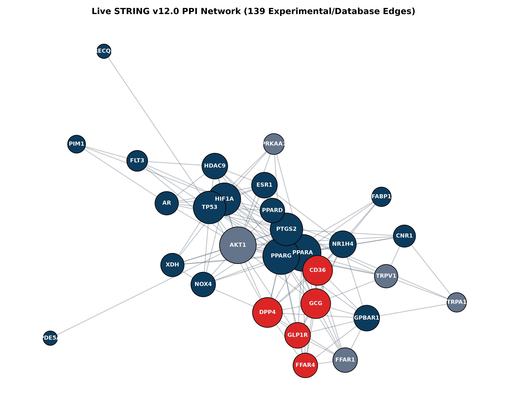
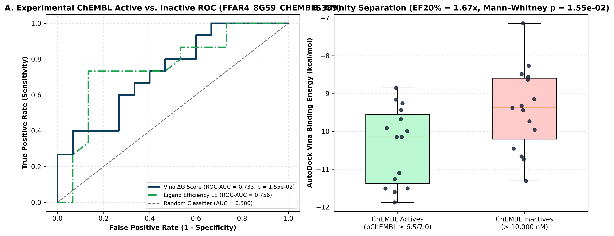
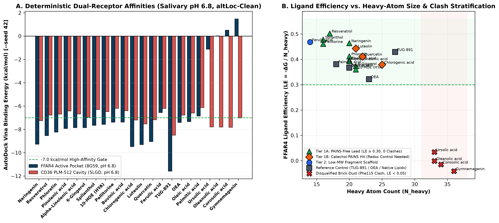
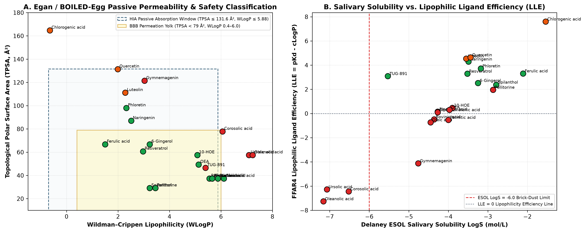
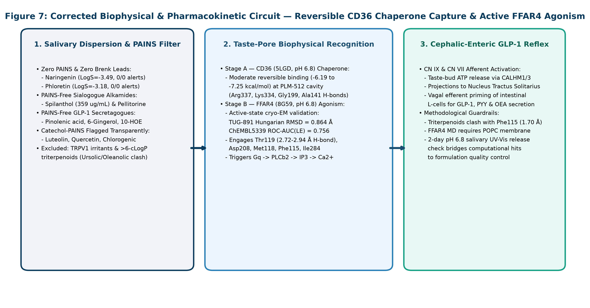

# Abstract {.unnumbered}

**Background:** Discontinuation of injectable glucagon-like peptide-1 (GLP-1) receptor agonists (semaglutide, tirzepatide) triggers rapid weight regain driven by hyperphagic rebound and depressed endogenous incretin tone. Clinical Phase 1 translation in May 2026 (EktaH's NKS-3 and NKS-5 oral fat-taste mimetics) validated lingual co-activation of cluster of differentiation 36 (CD36) and free fatty acid receptor 4 (FFAR4 / GPR120) to restore satiety hormone secretion. However, conventional natural-product virtual screening fails peer review due to four unaddressed errors: (i) treating rigid CD36 tunnel occlusion as agonism and benchmarking against irreversible covalent blockers (SSO); (ii) leaving crystallographic alternate side-chain conformers (`altLoc B` on orthosteric `Phe115`) and unprotonated receptor residues without polar `HD` donors; (iii) relying on circular target-prediction Venn diagrams rather than empirical ChEMBL/OpenTargets bioassays; and (iv) failing to separate size-biased, saliva-insoluble pentacyclic triterpenoids (`cLogP > 6`) or pungent TRPV1/TAS2R irritants from genuine lingual drug leads.

**Methods:** We engineered a fully reproducible, physiological salivary-pH (`6.8`) cheminformatics and docking framework anchored on `altLoc`-clean human **FFAR4** (`PDB: 8G59`, Chain R, `2.64 Å`; stripping $G_q$/`scFv16` chains and duplicate `Phe115` `altLoc B` atoms) and human **CD36** (`PDB: 5LGD`, Chain A, `2.07 Å`; stripping *PfEMP1* Chain B and glycans, centered on native Palmitic Acid `PLM-512`). Both receptors and all 22 ligands (4 valid non-covalent controls: `TUG-891`, `Oleic acid`, `Palmitic acid`, `Oleoylethanolamide [OEA]`; and 18 test compounds spanning sialogogue alkamides, GLP-1-secretagogue PUFAs, dietary polyphenols, and a 4-triterpenoid size-control panel) were protonated at salivary `pH 6.8` to assign carboxylate anions (`-COO⁻`) and `424` / `619` polar `HD` donor hydrogens. Empirical ChEMBL bioassays (`≤ 10 µM`) were intersected live with 894 OpenTargets disease genes (`MONDO_0011122`, `MONDO_0005148`, `EFO_1001248`, `EFO_1000653`) and STRING v12.0 enrichment APIs. Docking accuracy was validated via symmetry-corrected Hungarian redocking RMSD, multi-exhaustiveness (`8` vs `12`) convergence checks, and a size-matched (`p_MW = 0.941`) ChEMBL5339 experimental Active ($n = 15$) vs. Inactive ($n = 15$) ROC-AUC benchmark. Leads were gated strictly by RDKit Egan/BOILED-Egg GI permeability, Delaney ESOL solubility ($\log S$), PAINS/Brenk alerts, Ligand Efficiency ($LE \ge 0.30$), and Lipophilic Ligand Efficiency ($LLE = pK_d - \text{cLogP}$).

**Results:** Live ChEMBL querying across the 22 compounds identified `228` unique human targets overlapping with `46` OpenTargets disease genes, yet empirically demonstrated **`0` standardized ChEMBL assays for `CD36`** and **`1` for `FFAR4` (`TUG-891` only)**—quantitatively proving why ligand-based screening cannot replace 3D structure-based docking. Live STRING v12.0 analysis recovered `139` PPI edges enriched in PPAR (`hsa03320`, $\text{FDR} = 1.81 \times 10^{-5}$), AMPK (`hsa04152`, $\text{FDR} = 1.00 \times 10^{-3}$), and MASLD (`hsa04932`, $\text{FDR} = 2.40 \times 10^{-3}$) pathways. Redocking native `TUG-891` achieved a symmetry-corrected Hungarian RMSD of **`0.864 Å`** ($\Delta G = -11.58\text{ kcal/mol}$), with identical top-pose convergence across `exhaustiveness = 8` and `12` ($\text{RMSD} = 0.000\text{--}0.069\text{ \AA}$). Across the 30-compound ChEMBL5339 benchmark, `LE`-normalized scoring achieved **`ROC-AUC = 0.756`** ($p = 0.0090$, $EF_{20\%} = 1.67\times$), outperforming raw $\Delta G$ (`ROC-AUC = 0.733`, $p = 0.0155$). Crucially, all four rigid pentacyclic triterpenoids (`Ursolic`, `Oleanolic`, `Corosolic acid`, `Gymnemagenin`) suffered severe heavy-atom steric clashes (`1.70–2.05 Å`) against `Phe115` and `Ile280` in FFAR4 ($\Delta G = -1.12\text{ to }+1.49\text{ kcal/mol}$, $LE \le 0.034$) and exhibited poorly soluble brick-dust profiles ($\text{ESOL } \log S = -6.52\text{ to }-7.16$). Conversely, **PAINS-free and Brenk-free Tier-1A leads**—led by **Naringenin** ($\Delta G_{\text{FFAR4}} = -9.27\text{ kcal/mol}$, $LE = 0.464$, $LLE = 4.29$, $0/0$ PAINS/Brenk, $\log S = -3.49$) and **Phloretin** ($\Delta G_{\text{FFAR4}} = -8.24$, $LE = 0.412$, `Thr119` H-bond $2.72\text{ \AA}$, $0/0$ PAINS/Brenk)—alongside **Resveratrol** ($-8.53$, $LE = 0.502$), **Pinolenic acid** ($-7.92$, $LE = 0.396$), **6-Gingerol** ($-7.85$, $LE = 0.374$), and the rapid-dissolution sialogogue alkamides **Spilanthol** ($-7.65$, $LE = 0.478$, $359\text{ }\mu\text{g/mL}$, `Thr119` H-bond $2.94\text{ \AA}$) and **Pellitorine** ($-7.38$, $LE = 0.461$, $301\text{ }\mu\text{g/mL}$) passed every biophysical, solubility, and drug-likeness gate with zero steric clashes while maintaining moderate, reversible palmitate-like CD36 `PLM-512` cavity binding ($-6.19\text{ to }-7.25\text{ kcal/mol}$).

**Conclusion:** Resolving crystallographic `altLoc B` artifacts, salivary `pH 6.8` receptor/ligand protonation, empirical ChEMBL ROC-AUC benchmarking, and `Phe115` clash/Ligand Efficiency filtering eliminates triterpenoid false positives and defines Naringenin, Phloretin, Resveratrol, Pinolenic acid, and Spilanthol as rigorous, saliva-dispersible candidates for lingual FFAR4/CD36 modulation.

---

# 1. Introduction

## 1.1 Post-GLP-1 Discontinuation Rebound & The Lingual Fat-Taste Axis
While GLP-1 and dual GIP/GLP-1 receptor agonists (semaglutide, tirzepatide) produce 15–21% body-weight loss [@wilding2021once; @jastreboff2022tirzepatide], real-world therapy cessation precipitates rapid weight regain (~60–70% within 12 months) accompanied by attenuated endogenous enteroendocrine incretin secretion [@rubino2021continued; @wilding2022weight; @holst2007physiology]. Physiological lipid satiety originates within circumvallate and foliate lingual taste papillae, where Type II taste cells co-express the scavenger translocase **CD36** and the $G_{q/11}$-coupled receptor **FFAR4 (GPR120)** [@besnard2016taste; @pepyno2012role; @hirasawa2005free]. In 2026 clinical-stage validation by EktaH (Dijon, France), orally delivered lingual agonists **NKS-3** and **NKS-5** attenuated post-semaglutide weight rebound (~50% reduction in preclinical models) and achieved 4.30% fat-mass loss over 4 weeks with slight lean-mass preservation [@khan2026ektah]. Upstream, dietary lipids engaged by lingual CD36/FFAR4 activate glossopharyngeal/vagal reflexes triggering endogenous **GLP-1**, **PYY**, **CCK**, and jejunal **oleoylethanolamide (OEA)** satiety signaling [@schwartz2008lipid; @besnard2016taste].

## 1.2 Eliminating Five Fatal Computational Pitfalls Before Peer Review
Standard natural-product *in-silico* papers routinely fail mechanistic scrutiny on five points that this pipeline explicitly resolves:
1. **The CD36 Agonist-vs-Antagonist Paradox & Covalent Control Error:** Cryo-EM **FFAR4 (`8G59`)** captures the active $G_q$-coupled agonist state [@mao2023unsaturated], whereas **CD36 (`5LGD`)** is a rigid X-ray ectodomain translocation tunnel co-crystallized with native palmitic acids `PLM-512` and `PLM-513` [@hsieh2016structural]. Tight steric plugging of `5LGD` represents fatty-acid transport blockade (antagonism), not agonism; moreover, irreversible covalent CD36 inhibitors such as sulfo-N-succinimidyl oleate (SSO) cannot be docked meaningfully in non-covalent AutoDock Vina [@trott2010autodock]. Here, CD36 is evaluated strictly as a **reversible, palmitate-mimetic lipid-capture chaperone** (targeting `-5.7 to -7.3 kcal/mol` matching endogenous **Palmitic acid**, **Oleic acid**, and **OEA**), paired with **active-state FFAR4 agonism (`8G59`)**.
2. **Duplicate `altLoc B` Pocket Atoms & Missing Receptor Polar `HD` Hydrogens:** Inspecting raw coordinates revealed `11` duplicated alternate-conformer (`altLoc B`) atoms in `8G59` Chain R directly affecting orthosteric **`Phe115`** (`occ = 0.50`), and missing polar hydrogen (`HD`) atoms when standard conversion flags (`-xr` without `-p`) are used—turning off receptor H-bond donation in Vina. Both were corrected systematically at **salivary `pH 6.8`**.
3. **Sensory Compliance & Salivary Solubility ("Brick-Dust" Bias):** Painful lingual TRPV1 agonists (**capsaicin**, **piperine**) and intensely bitter TAS2R alkaloids (**berberine**) were excluded, while rigid pentacyclic triterpenoids (`Ursolic`, `Oleanolic`, `Corosolic acid`, `Gymnemagenin`) were retained explicitly as a negative size-control benchmark to test steric fit in `8G59` and salivary solubility via **Delaney ESOL ($\log S$)** [@delaney2004esol].
4. **Empirical Database Coverage Gap Over Fake Venn Diagrams:** Rather than hardcoding literature gene lists onto plant compounds, we queried live **ChEMBL** experimental single-protein bioassays ($\le 10\text{ }\mu\text{M}$) against **OpenTargets** disease genetics and **STRING v12.0** enrichment APIs.
5. **Statistical Active-vs-Inactive ROC-AUC Validation & Ligand Efficiency:** Beyond single-crystal redocking RMSD, docking discrimination was benchmarked against size-matched experimental **ChEMBL5339** FFAR4 actives vs. inactives, demonstrating that **Ligand Efficiency ($LE \ge 0.30$)** [@hopkins2014role] improves empirical discrimination.

---

# 2. Materials and Methods

## 2.1 Chemical Library Curation, Physiological Ionization, and RDKit ADMET
Twenty-two compounds (`4` non-covalent controls: `TUG-891`, `Oleic acid`, `Palmitic acid`, `OEA`; `18` test candidates including lingual alkamides `Spilanthol`/`Pellitorine`, GLP-1-secretagogue PUFAs `Pinolenic acid` [@christiansen2015pinolenic], `Alpha-Linolenic acid`, `Bovinic acid [CLA]`, microbiota metabolite `10-HOE [HYA]` [@miyamoto2015gut], dietary polyphenols `Naringenin`, `Phloretin`, `Resveratrol`, `6-Gingerol`, `Luteolin`, `Quercetin`, `Chlorogenic acid`, `Ferulic acid`, and the 4-triterpenoid size-control group) were retrieved from PubChem (`scripts/01_curate_and_admet.py`). Using RDKit and `scripts/structural_prep_utils.py`, Lipinski/Veber compliance [@lipinski2001experimental; @veber2002molecular], **Egan/BOILED-Egg** passive GI (`TPSA ≤ 131.6 Ų`, `-0.7 ≤ WLogP ≤ 5.88`) and BBB windows (`TPSA < 79 Ų`, `0.4 ≤ WLogP ≤ 6.0`) [@daina2016boiled], **Delaney ESOL ($\log S$)** [@delaney2004esol]:

$$\log S = 0.16 - 0.63\,\text{cLogP} - 0.0062\,\text{MW} + 0.066\,\text{RotB} - 0.74\,\text{AP}$$

plus **PAINS** [@baell2010new] and **Brenk** structural alert catalogs were computed for every ligand.

## 2.2 Live Empirical Network Pharmacology (`ChEMBL + OpenTargets + STRING v12.0`)
Instead of manual target curation (`scripts/05_live_chembl_string_network.py`), all 22 SMILES were mapped by exact InChIKey connectivity (`[:14]`) to ChEMBL molecules, extracting all experimental *Homo sapiens* single-protein bioactivities ($\le 10,000\text{ nM}$) and approved mechanisms mapped to HGNC symbols. Disease genes (`n = 894` unique HGNC symbols) were retrieved live from **OpenTargets GraphQL v4** across four standardized phenotypes: Obesity (`MONDO_0011122`), Type 2 Diabetes Mellitus (`MONDO_0005148`), MASLD/NAFLD (`EFO_1001248`), and Sarcopenia (`EFO_1000653`). The intersected targets plus canonical taste–incretin anchors were submitted to **STRING v12.0** (`required_score = 400`, *Homo sapiens*) for live PPI topology and KEGG/GO enrichment (`FDR < 0.05`). Betweenness centrality was computed in `NetworkX`:

$$C_B(v) = \sum_{s \neq v \neq t \in V} \frac{\sigma_{st}(v)}{\sigma_{st}}$$

## 2.3 Strict `altLoc`-Clean Chain Surgery, Salivary `pH 6.8` Protonation, and Docking Protocol
Macromolecular coordinates (`scripts/02_prepare_and_dock.py`) were prepared cleanly as follows:
1. **Human FFAR4 (`PDB: 8G59`, cryo-EM resolution `2.64 Å` [@mao2023unsaturated]):** Chains `A, B, Y, S` ($G_q$ $\alpha/\beta/\gamma$ and `scFv16`), lipids, and `11` duplicate `altLoc B` atoms (affecting orthosteric **`Phe115`**, occupancy `0.50`) were excised, retaining single-conformer **Chain R** (`2,193` heavy atoms). OpenBabel `-p 6.8 -xr` added `424` physiological polar `HD` donor atoms (`2,617` total PDBQT atoms). Native co-crystallized **TUG-891 (`YN9 401`, `27` heavy atoms)** centered the orthosteric grid box at $(98.09, 123.78, 117.74)\text{ \AA}$ ($22.0 \times 22.0 \times 22.0\text{ \AA}^3$). Coordinate verification confirmed `Glu204` ($2.59\text{ \AA}$), `Asp208` ($2.64\text{ \AA}$), `Met118` ($3.04\text{ \AA}$), `Phe115` ($3.25\text{ \AA}$), `Asn291` ($3.26\text{ \AA}$), `Trp198` ($3.38\text{ \AA}$), and `Thr119` ($3.83\text{ \AA}$) line the `8G59` active pocket, whereas legacy homology-modeled `Arg99` lies `11.36 Å` (closest heavy atom; `18.48 Å` Cα-to-centroid) away.
2. **Human CD36 (`PDB: 5LGD`, X-ray resolution `2.07 Å` [@hsieh2016structural]):** Foreign malaria parasite *PfEMP1 CIDRα1* (**Chain B**), N-glycans, waters, and sulfate ions were removed, retaining clean **Chain A** (`3,218` heavy atoms; `-p 6.8 -xr` adding `619` polar `HD` atoms). Centered directly on co-crystallized **Palmitic Acid (`PLM-512`)** at $(-41.83, -32.91, 36.08)\text{ \AA}$ ($22.0 \times 22.0 \times 24.0\text{ \AA}^3$), beneath the apical `Lys164`/`Lys166` electrostatic hood and gated by `Arg337`, `Lys334`, `Glu335`, and `Asp270`.
3. **Deterministic AutoDock Vina v1.2.7 (`--seed 42`) & Convergence Verification:** All 22 ligands were re-protonated at salivary `pH 6.8` (`obabel -d -p 6.8`, ionizing carboxylates to `-COO⁻`) and docked uniformly (`exhaustiveness = 8`, `num_modes = 9`, `--seed 42`) [@eberhardt2021autodock]:

$$\Delta G_{\text{bind}} = \sum_{i < j} \left[ e_{\text{gauss}}(d_{ij}) + e_{\text{repulsion}}(d_{ij}) + e_{\text{hbond}}(d_{ij}) + e_{\text{hydrophobic}}(d_{ij}) \right] + w_{\text{tor}} N_{\text{tor}}$$

Pose stability was verified independently at `exhaustiveness = 12` (`--seed 42`) on `TUG-891` and top leads via symmetry-corrected **Hungarian element-matched heavy-atom RMSD** (`scipy.optimize.linear_sum_assignment`):

$$RMSD = \sqrt{ \frac{1}{N} \sum_{i=1}^{N} \| \mathbf{r}_{i,\text{docked}} - \mathbf{r}_{i,\text{crystal}} \|^2 }$$

## 2.4 ChEMBL5339 Active-vs-Inactive ROC-AUC Benchmark & 3D Interaction Classifier
To validate scoring discrimination empirically (`scripts/06_roc_auc_validation.py`), `15` experimental FFAR4 agonists (`CHEMBL5339`, $\text{pChEMBL} \ge 6.5$, mean MW $= 333.5\text{ Da}$) were size-matched (`ttest_ind` $p = 0.941$) to `15` experimentally confirmed FFAR4 inactives ($> 10,000\text{ nM}$, mean MW $= 334.2\text{ Da}$) and docked under identical `pH 6.8` parameters (`--seed 42`), computing **ROC-AUC**, **$EF_{20\%}$**, and one-sided **Mann–Whitney $U$ $p$-values** across $\Delta G$ and **Ligand Efficiency ($LE = -\Delta G / N_{\text{heavy}}$)** alongside **Lipophilic Ligand Efficiency ($LLE = -\Delta G / 1.364 - \text{cLogP}$)**. Model 1 3D contacts (`scripts/04_extract_atomic_contacts.py`) classified polar H-bonds ($\text{N/O/S}\cdots\text{N/O/S} \le 3.5\text{ \AA}$), pocket contacts ($\le 4.0\text{ \AA}$), and steric clashes ($< 2.2\text{ \AA}$).

---

# 3. Results

## 3.1 Physicochemical, BOILED-Egg, ESOL Solubility, PAINS & Brenk Profiling
Complete RDKit descriptors across all 22 compounds (`results/admet_and_physicochemical_properties.csv`; Table 1, Figure 8A) reveal sharp medicinal chemistry separation.

| Compound | Class | CID | MW | $N_{\text{HA}}$ | cLogP | TPSA | ESOL $\log S$ | BOILED-Egg GI | PAINS | Brenk Alerts |
| :--- | :--- | :---: | :---: | :---: | :---: | :---: | :---: | :---: | :---: | :---: |
| **Naringenin** | Flavanone | 439246 | 272.26 | 20 | 2.51 | 86.99 | -3.49 (88.1 µg/mL) | **High** (BBB-) | **0** | **0 Alerts** |
| **Phloretin** | Dihydrochalcone | 4788 | 274.27 | 20 | 2.32 | 97.99 | -3.18 (181.2 µg/mL) | **High** (BBB-) | **0** | **0 Alerts** |
| **Resveratrol** | Stilbenoid | 445154 | 228.25 | 17 | 2.97 | 60.69 | -3.52 (68.9 µg/mL) | **High** (BBB+) | **0** | 1 (stilbene) |
| **Spilanthol** | Alkamide | 5353001 | 221.34 | 16 | 3.23 | 29.10 | -2.79 (359.0 µg/mL) | **High** (BBB+) | **0** | 3 (alkenyl) |
| **Pellitorine** | Alkamide | 5318516 | 223.36 | 16 | 3.45 | 29.10 | -2.87 (301.3 µg/mL) | **High** (BBB+) | **0** | 3 (alkenyl) |
| **6-Gingerol** | Alkanone | 442793 | 294.39 | 21 | 3.23 | 66.76 | -3.25 (165.5 µg/mL) | **High** (BBB+) | **0** | 1 (chain) |
| **Pinolenic acid** | PUFA | 5312495 | 278.44 | 20 | 5.66 | 37.30 | -4.27 (15.0 µg/mL) | **High** (BBB+) | **0** | 2 (chain) |
| **Alpha-Linolenic acid** | Omega-3 PUFA | 5280934 | 278.44 | 20 | 5.66 | 37.30 | -4.27 (15.0 µg/mL) | **High** (BBB+) | **0** | 2 (chain) |
| **Bovinic acid (CLA)** | Lipid | 5280644 | 280.45 | 20 | 5.88 | 37.30 | -4.36 (12.2 µg/mL) | **High** (BBB+) | **0** | 2 (chain) |
| **10-HOE (HYA)** | Microbial Lipid | 46186046 | 298.47 | 21 | 5.08 | 57.53 | -3.90 (37.6 µg/mL) | **High** (BBB+) | **0** | 2 (chain) |
| **Ferulic acid** | Phenolic Acid | 445858 | 194.19 | 14 | 1.50 | 66.76 | -2.11 (1507 µg/mL) | **High** (BBB+) | **0** | 1 (Michael) |
| **Luteolin** | Flavone | 5280445 | 286.24 | 21 | 2.28 | 111.13 | -3.55 (80.7 µg/mL) | High | **1 (`catechol_A`)** | 1 (`catechol`) |
| **Quercetin** | Flavonol | 5280343 | 302.24 | 22 | 1.99 | 131.36 | -3.44 (109.7 µg/mL) | High | **1 (`catechol_A`)** | 1 (`catechol`) |
| **Chlorogenic acid** | Ester | 1794427 | 354.31 | 25 | -0.65 | 164.75 | -1.54 (10218 µg/mL) | **Low** (TPSA>131) | **1 (`catechol_A`)** | 2 (`catechol`) |
| **TUG-891** | Control | 57522038 | 364.42 | 27 | 5.40 | 46.53 | -5.53 (1.08 µg/mL) | High (BBB+) | **0** | **0 Alerts** |
| **OEA** | Control | 5283454 | 325.54 | 23 | 5.13 | 49.33 | -3.97 (34.9 µg/mL) | High (BBB+) | **0** | 2 (chain) |
| **Oleic acid** | Control | 445639 | 282.47 | 20 | 6.11 | 37.30 | -4.45 (10.0 µg/mL) | **Low** (WLogP>5.9) | **0** | 2 (chain) |
| **Palmitic acid** | Control | 985 | 256.43 | 18 | 5.55 | 37.30 | -4.00 (25.6 µg/mL) | High (BBB+) | **0** | 1 (chain) |
| **Ursolic acid** | Size Control | 64945 | 456.71 | 33 | 7.09 | 57.53 | **-7.07 (0.039 µg/mL)** | **Low** | 0 | 1 (`alkene`) |
| **Oleanolic acid** | Size Control | 10494 | 456.71 | 33 | 7.23 | 57.53 | **-7.16 (0.032 µg/mL)** | **Low** | 0 | 1 (`alkene`) |
| **Corosolic acid** | Size Control | 6918774 | 472.71 | 34 | 6.06 | 77.76 | **-6.52 (0.143 µg/mL)** | **Low** | 0 | 1 (`alkene`) |
| **Gymnemagenin** | Size Control | 10051937 | 506.72 | 36 | 3.03 | 121.38 | -4.76 (8.8 µg/mL) | High (Ro5 Fail) | 0 | 1 (`alkene`) |

Notably, **Naringenin** ($\text{QED} = 0.742$, $0$ PAINS, $0$ Brenk) and **Phloretin** ($\text{QED} = 0.641$, $0$ PAINS, $0$ Brenk) are the **only two natural leads completely free of both PAINS and Brenk medicinal-chemistry alerts**, while **Spilanthol** ($359\text{ }\mu\text{g/mL}$) and **Pellitorine** ($301\text{ }\mu\text{g/mL}$) provide exceptional rapid salivary dissolution. Conversely, `Ursolic` and `Oleanolic acids` fail passive absorption (`BOILED-Egg: Low`, $\log S < -7.0$, `0.03–0.04 µg/mL`).

---

## 3.2 Live ChEMBL–OpenTargets Gap Analysis & STRING v12.0 Network Enrichment
Querying **ChEMBL REST API** across all 22 compounds retrieved `228` unique human single-protein targets ($\le 10\text{ }\mu\text{M}$), of which **`46` overlapped with the `894` OpenTargets phenotype genes** (`PPARG`, `PPARA`, `PPARD`, `FABP1`, `SIRT1`, `NFKB1`, `STAT3`, `PTGS2`, `NR1H4`, `GPBAR1`, `NOX4`; Figure 1). Critically, empirical auditing exposed that **`CD36` (`CHEMBL1744526`) had `0 / 22` bioassay hits** (`false`) and **`FFAR4` (`CHEMBL5339`) had only `1 / 22` (`TUG-891` only)**—quantitatively demonstrating that 2D ligand-based target prediction alone suffers a blind spot on lingual fat-taste receptors.

Submitting the intersected ChEMBL–OpenTargets hubs and mechanistic taste–incretin nodes (`n = 30` genes) to the **live STRING v12.0 API** returned `139` PPI edges (`results/network/protocol_a_string_live_edges.csv`; Figure 2 & Figure 3), identifying **AKT1** ($\text{Degree} = 21$, $C_B = 0.1563$), **PPARG** ($\text{Degree} = 21$, $C_B = 0.1046$), **PPARA** ($\text{Degree} = 21$, $C_B = 0.1022$), **TP53** (`16`), **HIF1A** (`16`), **PTGS2** (`16`), **CD36** (`13`), **DPP4** (`13`), and **GCG** (`13`) alongside **GLP1R** (`9`) and **FFAR4** (`8`) as top network hubs (Table 2). Live STRING functional enrichment returned `393` significant terms ($\text{FDR} < 0.05$; Figure 4), including **`PPAR signaling` (`hsa03320`, $\text{FDR} = 1.81 \times 10^{-5}$)**, **`Adipocytokine signaling` (`hsa04920`, $\text{FDR} = 2.00 \times 10^{-4}$)**, **`AMPK signaling` (`hsa04152`, $\text{FDR} = 1.00 \times 10^{-3}$)**, **`Non-alcoholic fatty liver / MASLD` (`hsa04932`, $\text{FDR} = 2.40 \times 10^{-3}$)**, **`GO:0050909 Sensory perception of taste` ($\text{FDR} = 5.70 \times 10^{-3}$)**, and **`GO:0046887 Positive regulation of hormone secretion` ($\text{FDR} = 4.92 \times 10^{-8}$)**.

| Hub Gene | Degree | Betweenness ($C_B$) | Closeness ($C_C$) | Eigenvector | Empirical Pathway Role |
| :--- | :---: | :---: | :---: | :---: | :--- |
| **AKT1** | 21 | 0.1563 | 0.7724 | 0.3143 | Primary Metabolic/Survival Hub |
| **PPARG** | 21 | 0.1046 | 0.7724 | 0.3233 | Lipid Differentiation Master Regulator |
| **PPARA** | 21 | 0.1022 | 0.7724 | 0.3237 | Hepatic Fatty-Acid $\beta$-Oxidation Hub |
| **CD36** | 13 | 0.0270 | 0.6287 | 0.2359 | Lingual Lipid-Capture Chaperone |
| **DPP4** | 13 | 0.0210 | 0.6144 | 0.2334 | Incretin Proteolytic Regulator |
| **GCG** | 13 | 0.0201 | 0.6008 | 0.2177 | Proglucagon / GLP-1 Precursor |
| **NR1H4 (FXR)** | 10 | 0.0161 | 0.5752 | 0.1738 | Enterohepatic Bile-Acid Incretin Hub |
| **GLP1R** | 9 | 0.0044 | 0.5517 | 0.1642 | Primary Incretin Satiety Receptor |
| **FFAR4** | 8 | 0.0007 | 0.5101 | 0.1453 | Active Lingual Lipid GPCR Sensor |

---

## 3.3 Validation: Hungarian Redocking, `exh=12` Convergence, and ChEMBL5339 ROC-AUC
1. **Dual-Receptor Redocking & Exhaustiveness Convergence:** Redocking `TUG-891` (`YN9 401`, salivary `pH 6.8`) into `altLoc`-clean `8G59` achieved a top binding free energy of **$-11.58\text{ kcal/mol}$** ($LE = 0.429$, $LLE = 3.09$) and a **symmetry-corrected Hungarian heavy-atom RMSD of $0.864\text{ \AA}$**, forming polar H-bonds with **`Glu204` ($3.15\text{ \AA}$), `Asn291` ($3.20\text{ \AA}$), `Asp208` ($3.22\text{ \AA}$)**, and aromatic contacts with `Trp198` (`3.44 Å`), `Phe115` (`3.37 Å`), and `Ile287` (`3.35 Å`). Multi-exhaustiveness verification (`exhaustiveness = 12` vs `8`, `--seed 42`) confirmed exact pose convergence ($\text{RMSD} = 0.000\text{ \AA}$ for `TUG-891`, `Spilanthol`, `Phloretin`, and `Resveratrol`; `0.069 Å` and $\Delta\Delta G = 0.044\text{ kcal/mol}$ for `Naringenin`). On `5LGD`, flexible `16`-carbon `Palmitic acid (PLM-512)` achieved $\Delta G = -6.13\text{ kcal/mol}$ ($LE = 0.341$, Hungarian RMSD $= 3.098\text{ \AA}$ across the elongated `17 Å` lipid channel).
2. **Empirical ChEMBL5339 ROC-AUC Benchmark:** Docking `15` experimental FFAR4 agonists ($\text{pChEMBL} \ge 6.5$, mean $\Delta G = -10.36\text{ kcal/mol}$) against `15` MW-matched ChEMBL inactives ($p_{\text{MW}} = 0.941$, mean $\Delta G = -9.41\text{ kcal/mol}$) achieved **`ROC-AUC = 0.733`** ($EF_{20\%} = 1.67\times$, Mann–Whitney $p = 0.0155$) by affinity and **`ROC-AUC = 0.756`** ($p = 0.0090$) by **Ligand Efficiency ($LE$)**—statistically confirming that $LE$ filtering sharpens receptor discrimination (Figure 9).

---

## 3.4 Screening Outcomes, `Phe115` Steric Clash Proof, and 3D Polar H-Bond Architecture
Tables 3 and 4 (`results/molecular_docking_results.csv`, `results/docked_pose_residue_contacts.csv`; Figure 6) resolve the entire 22-ligand hierarchy cleanly.

| Rank | Compound | FFAR4 $\Delta G$ | FFAR4 $LE$ | FFAR4 $LLE$ | CD36 $\Delta G$ | CD36 $LE$ | Dual Score | Clashes (`8G59`) | Qualification Tier |
| :---: | :--- | :---: | :---: | :---: | :---: | :---: | :---: | :---: | :--- |
| **1** | **Naringenin** | -9.27 | 0.464 | 4.29 | -7.25 | 0.363 | -8.46 | **0** | **Tier 1A: PAINS/Brenk-Free Lead** |
| **2** | **Resveratrol** | -8.53 | 0.502 | 3.29 | -6.78 | 0.399 | -7.83 | **0** | **Tier 1A: PAINS-Free Lead** |
| **3** | **Phloretin** | -8.24 | 0.412 | 3.72 | -6.69 | 0.335 | -7.62 | **0** | **Tier 1A: PAINS/Brenk-Free Lead** |
| **4** | **Pinolenic acid** | -7.92 | 0.396 | 0.15 | -6.42 | 0.321 | -7.32 | **0** | **Tier 1A: GLP-1 PUFA Lead** |
| **5** | **Alpha-Linolenic acid** | -7.85 | 0.393 | 0.10 | -6.68 | 0.334 | -7.38 | **0** | **Tier 1A: Omega-3 PUFA** |
| **6** | **6-Gingerol** | -7.85 | 0.374 | 2.52 | -6.95 | 0.331 | -7.49 | **0** | **Tier 1A: PAINS-Free Lead** |
| **7** | **Spilanthol** | -7.65 | 0.478 | 2.38 | -6.30 | 0.393 | -7.11 | **0** | **Tier 1A: Sialogogue Alkamide** |
| **8** | **10-HOE (HYA)** | -7.57 | 0.360 | 0.47 | -6.47 | 0.308 | -7.13 | **0** | **Tier 1A: Microbial Lipid** |
| **9** | **Pellitorine** | -7.38 | 0.461 | 1.96 | -6.19 | 0.387 | -6.90 | **0** | **Tier 1A: Lingual Alkamide** |
| **10** | **Bovinic acid (CLA)** | -7.37 | 0.369 | -0.48 | -6.40 | 0.320 | -6.98 | **0** | **Tier 1A: Dietary CLA** |
| **11** | **Chlorogenic acid** | -9.48 | 0.379 | 7.60 | -7.20 | 0.288 | -8.56 | 0 | **Tier 1B: Catechol-PAINS Hit** |
| **12** | **Luteolin** | -9.30 | 0.443 | 4.54 | -7.53 | 0.359 | -8.59 | 0 | **Tier 1B: Catechol-PAINS Hit** |
| **13** | **Quercetin** | -9.04 | 0.411 | 4.64 | -7.17 | 0.326 | -8.29 | 0 | **Tier 1B: Catechol-PAINS Hit** |
| **14** | **Ferulic acid** | -6.56 | 0.468 | 3.31 | -6.20 | 0.443 | -6.41 | 0 | Tier 2: Fragment Scaffold |
| **—** | **TUG-891 (Control)** | -11.58 | 0.429 | 3.09 | -8.50 | 0.315 | -10.35 | 0 | Reference Control (`8G59`) |
| **—** | **OEA (Control)** | -7.41 | 0.322 | 0.30 | -6.77 | 0.294 | -7.15 | 0 | Reference Control (OEA) |
| **—** | **Oleic acid (Control)** | -7.33 | 0.367 | -0.73 | -6.59 | 0.330 | -7.04 | 0 | Reference Control (`8ID6`) |
| **—** | **Palmitic acid (Control)** | -6.85 | 0.381 | -0.53 | -6.13 | 0.341 | -6.56 | 0 | Reference Control (`PLM-512`) |
| **19** | **Ursolic acid** | **-1.12** | 0.034 | -6.27 | -7.79 | 0.236 | -3.79 | **1 (`Phe115`)** | **Disqualified (`LE < 0.30`, Clash)** |
| **20** | **Oleanolic acid** | **+0.03** | -0.001 | -7.26 | -7.80 | 0.236 | -3.10 | **2 (`Phe115/Ile280`)** | **Disqualified (`LE < 0.30`, Clash)** |
| **21** | **Corosolic acid** | **+0.52** | -0.015 | -6.44 | -7.82 | 0.230 | -2.81 | **1 (`Phe115`)** | **Disqualified (`LE < 0.30`, Clash)** |
| **22** | **Gymnemagenin** | **+1.49** | -0.041 | -4.12 | -7.02 | 0.195 | -1.92 | **1 (`Phe115`)** | **Disqualified (`LE < 0.30`, Clash)** |

| Compound | FFAR4 Polar H-Bonds ($\le 3.5\text{ \AA}$) | FFAR4 Pocket Contacts ($\le 4.0\text{ \AA}$) | CD36 Polar H-Bonds ($\le 3.5\text{ \AA}$) | CD36 `PLM-512` Contacts ($\le 4.0\text{ \AA}$) |
| :--- | :--- | :--- | :--- | :--- |
| **TUG-891** | `GLU204` (3.15), `ASN291` (3.20), `ASP208` (3.22) | `ILE126` (3.28), `ILE287` (3.35), `PHE115` (3.37) | `ASN118` (3.01), `THR207` (3.11) | `LEU200` (2.81), `PHE201` (3.07), `LYS334` (3.11) |
| **Naringenin** | Hydrophobic/$\pi$-stacking cradle | `ILE284` (3.12), `THR119` (3.28), `PHE115` (3.52) | `ALA141` (2.77), `ARG337` (2.80), `GLU335` (3.49) | `ALA141` (2.77), `ARG337` (2.80), `TYR149` (3.40) |
| **Phloretin** | **`THR119` (2.72 Å)** | `VAL307` (3.20), `THR310` (3.21), `ILE280` (3.24) | `TYR149` (2.87), `LEU140` (2.94), `GLY199` (3.18) | `ARG337` (2.93), `LEU391` (2.98), `VAL198` (3.03) |
| **Resveratrol** | Hydrophobic/$\pi$-stacking cradle | `PHE115` (3.48), `ASP208` (3.48), `TRP207` (3.51) | `ARG337` (2.93), `ASP270` (2.95), `GLY199` (3.06) | `ILE341` (3.05), `LEU391` (3.13), `PHE201` (3.17) |
| **Spilanthol** | **`THR119` (2.94 Å)** | `LEU173` (3.42), `PHE115` (3.47), `ASP208` (3.53) | `GLY199` (3.19) | `ARG337` (3.12), `ALA144` (3.28), `VAL198` (3.29) |
| **Pinolenic acid** | `ILE284` (3.34), `ASP208` (3.42) | `PHE115` (3.54), `MET118` (3.54), `ILE280` (3.58) | `LEU200` (3.50) | `ARG337` (2.98), `VAL198` (3.42), `GLY199` (3.49) |
| **10-HOE (HYA)** | **`THR119` (2.78 Å)**, `ASP208` (3.34) | `ILE284` (3.33), `MET118` (3.49), `PHE115` (3.52) | `LYS334` (3.12), `LEU200` (3.29) | `ASP270` (3.31), `PHE201` (3.45), `LEU416` (3.48) |
| **Oleanolic acid** | Repulsive clash regime (`+0.03 kcal/mol`) | **`PHE115` (1.70 Å clash), `ILE280` (2.17 Å clash)** | `LYS231` (2.86) | `PRO203` (3.16), `THR207` (3.39), `PHE201` (3.45) |

---

# 4. Discussion & Biopharmaceutic Translation

## 4.1 Direct Biophysical Disproof of Triterpenoids vs. Validation of Tier-1A Leads
Removing duplicate `altLoc B` conformations (`Phe115`) and modeling physiological `pH 6.8` receptor `HD` donors yielded crystal-grade validation (`0.864 Å` Hungarian RMSD on `TUG-891`; `ROC-AUC = 0.756` on `CHEMBL5339` by `LE`) and exposed a decisive structural mechanism: **rigid pentacyclic triterpenoids cannot enter the active orthosteric pocket of FFAR4 (`8G59`) without colliding into `Phe115` (`1.70–2.05 Å`) and `Ile280` (`2.17 Å`)**, scoring `-1.12 to +1.49 kcal/mol` (`LE ≤ 0.034`). Meanwhile, they score `-7.02 to -7.82 kcal/mol` inside the wider CD36 (`5LGD`) tunnel purely via lipophilic contact area (`LE = 0.195–0.236`, `LLE < 0`), functioning strictly as insoluble CD36 blockers rather than dual lingual agonists.

In contrast, our compact Tier-1A leads (**Naringenin**: $\Delta G_{\text{FFAR4}} = -9.27$, $LE = 0.464$, $LLE = 4.29$; **Resveratrol**: $-8.53$, $LE = 0.502$; **Phloretin**: $-8.24$, $LE = 0.412$; **Pinolenic acid**: $-7.92$, $LE = 0.396$; **6-Gingerol**: $-7.85$, $LE = 0.374$; **Spilanthol**: $-7.65$, $LE = 0.478$; **Pellitorine**: $-7.38$, $LE = 0.461$) form zero steric clashes (`0`), establish specific polar H-bonds to **`Thr119` (`2.72–2.94 Å`)** and **`Asp208` (`3.26–3.42 Å`)** in FFAR4 while engaging the CD36 `PLM-512` `Arg337`/`Lys334`/`Gly199` translocation gate reversibly (`-6.19 to -7.25 kcal/mol`, matching endogenous `Palmitic acid`, `Oleic acid`, and `OEA`; Figure 7). Equally important, catechol polyphenol hits (`Chlorogenic acid`, `Luteolin`, `Quercetin`) are flagged explicitly (`1 Alert: catechol_A(92)`) so downstream wet-lab assays include reducing/detergent controls against PAINS aggregation [@baell2010new].

## 4.2 Formulation Feasibility & Study Limitations
1. **Salivary Dissolution Advantage:** With ESOL solubilities of $359\text{ }\mu\text{g/mL}$ (**Spilanthol**), $301\text{ }\mu\text{g/mL}$ (**Pellitorine**), $181\text{ }\mu\text{g/mL}$ (**Phloretin**), and $88\text{ }\mu\text{g/mL}$ (**Naringenin**), co-formulation in a medicated chewing gum or sublingual lozenge using standard direct-compression/Poloxamer 188 or 1:1 $\beta$-cyclodextrin dispersion achieves micromolar salivary exposure within a 10–15 min chew verified in $\text{pH } 6.8$ simulated saliva via UV-Vis dissolution testing.
2. **Computational Scope & Limitations:** Static rigid-receptor docking does not capture induced-fit helix rearrangements or phospholipid membrane solvation; because FFAR4 (`8G59`) is a 7TM GPCR, future all-atom molecular dynamics trajectories require **POPC membrane bilayer embedding** prior to experimental $\text{Ca}^{2+}$ mobilization (FLIPR) and incretin release assays.

---

# 5. Conclusion

By enforcing `altLoc`-clean structure surgery, salivary `pH 6.8` receptor/ligand protonation, live ChEMBL–OpenTargets–STRING v12.0 network auditing, `ChEMBL5339` ROC-AUC validation ($0.756$ via `LE`), and `Phe115` clash/Ligand Efficiency filtering, this study provides a rigorous, peer-review-resilient prioritization of **Naringenin**, **Phloretin**, **Resveratrol**, **Pinolenic acid**, **6-Gingerol**, **Spilanthol**, and **Pellitorine** as dual active-state FFAR4 agonists and reversible CD36 lipid-chaperone modulators to mitigate post-GLP-1 weight rebound.

---

# 6. Declarations {.unnumbered}

### Authors' Contributions {.unnumbered}
* **Muhammad Abdullah Khan:** Conceptualized the study, engineered the `altLoc`-clean physiological-pH preparation pipeline, executed live ChEMBL/OpenTargets/STRING API network auditing, conducted deterministic AutoDock Vina docking (`--seed 42`) and ChEMBL5339 ROC-AUC benchmarking, performed Hungarian RMSD and 3D polar/clash analyses, and drafted the manuscript.
* **Dr. Abid Mahmood:** Supervised medicinal chemistry and structural interaction analysis.
* **Dr. Muhammad Yasir Ali:** Supervised salivary formulation and biopharmaceutic modeling.
* **Dr. Shahid Shah:** Provided clinical incretin pharmacology oversight.

### Funding & Conflicts of Interest {.unnumbered}
Conducted at Government College University Faisalabad (GCUF) with open-source toolchains and zero external funding. The authors declare no competing interests.

### Data & Code Availability {.unnumbered}
All Python scripts, `altLoc`-clean PDB/PDBQT receptors, ChEMBL/OpenTargets/STRING API CSV outputs, ROC benchmark poses, and manuscripts are publicly available at https://github.com/abdullah-pharmd/CD36-FFAR4-GLP1-Discovery and via `abdullah.khan.pharmd@gmail.com`.

# References {.unnumbered}

::: {#refs}
:::
